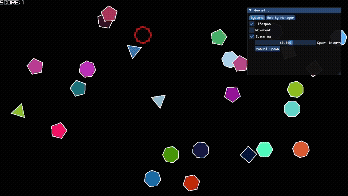

# Geometry — Arcade Shooter

A fast-paced arcade shooter inspired by **Geometry Wars**, where geometric enemies swarm the arena, bullets shatter polygons into smaller fragments, and every kill earns you points.

Survive, shoot, dodge, and rack up the highest score you can!

## Gameplay

Destroy geometric enemies scattered throughout the arena. Larger polygons break apart into smaller ones when hit, creating increasingly chaotic encounters. Each destroyed enemy rewards you with score, encouraging you to keep moving and survive as long as possible.

## Features

- Arcade-style shooting gameplay inspired by Geometry Wars
- Polygon enemies that split into smaller fragments when destroyed
- Score system rewarding enemy destruction
- Entity Component System (ECS) architecture built in C++
- Modular systems for movement, collision detection, input, and entity lifespan
- Debug tools for inspecting and testing gameplay systems
- Built with C++17 and Raylib

## Tech Stack

- **Language:** C++17
- **Graphics & Game Framework:** [Raylib](https://www.raylib.com/)
- **GUI:** Dear ImGui
- **Build System:** CMake

## Screenshots

<p align="center">
  
</p>

## Architecture

This project uses an Entity Component System (ECS) architecture to organize gameplay logic and separate responsibilities across different systems.

Some of the systems implemented include:

- Input System
- Movement System
- Collision System
- Lifespan System
- Entity Management
- System Management

The ECS architecture allows entities to be composed of different components while systems independently handle their behavior.

## Inspiration & Acknowledgements

This project was developed as a learning project inspired by the Geometry Wars arcade genre and gameplay concepts explored in the following course.

- **Course / Tutorial:** [COMP 4300 - C++ Game Programming - Fall 2026](https://youtube.com/playlist?list=PLdEgIOpXtE-s&si=c3uooOr2vmnaaCZB)

The course served as a learning reference, while the game implementation and ongoing development provided an opportunity to explore C++, ECS architecture, game systems, and gameplay programming.

## Building

This project uses CMake and requires a C++17-compatible compiler.

```bash
git clone https://github.com/ttinonin/geometry.git
cd geometry
cmake -B build -S .
cmake --build build --config Release
```